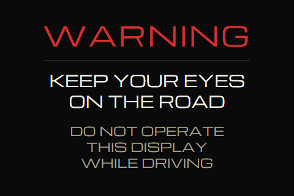

# V0.30 boot + shutdown sequence — design spec

**Author:** Iris (UI/UX) · **Date:** 2026-10-13, **refreshed 2026-10-23 (UIDEV-014) against dev `6e8eb475`** · **Status:** CIO-APPROVED design; words and image final for S114 grooming
**Storyboard:** `proposals/2026-10-13-v030-boot-shutdown.html` → https://claude.ai/artifact/HfQ1QVUq7N9EbBunrSF4hi (the 10-13 storyboard. Its logo is a placeholder, and its words are superseded by §1.3 and §2.2 here)
**WARNING image:** `specs/assets/boot/warning-480x320.png`, source `warning.svg` beside it (§1.2)
**DoD lines served:** 11 (boot: driving warning → logo → ends when actually collecting, real readiness signals; shutdown: sync bar from the real backlog that looks stalled when stalled), 1 (the boot metric's phases)
**Stories:** US-785 (warning screen) · US-869 (sequencing) · US-870 (sync bar) · US-883 (shutdown-state step + sync) · US-885 (Plymouth phase 0) · US-551 (visual verify, §6) · US-760 (ruled in §6) · relates to US-651/652 (splashes on labwc), US-858/859/866 (OS boot path)
**Sprint:** **S114, after the labwc switch** (Atlas O1, 2026-10-23: S113 = US-886 → US-651 → US-652 + US-885). Designed for the labwc Wayland kiosk; nothing here depends on X11 (§4).
**Style:** 90s Mitsubishi OEM (`v030-frame-and-style-design.md`); tokens and Michroma as shipped by US-887-a/b
**Canonical home:** `specs/` in the repo via a bench.

### What changed on 2026-10-23 (UIDEV-014)

| Was (10-13) | Now | Why |
|---|---|---|
| Hand-off by `plymouth quit --retain-splash`, kiosk unit `After=` plymouth-quit | **lightdm quits Plymouth itself** (`Conflicts=` + `After=plymouth-quit.service`) | ADR 2026-08-30 §11.3 (design A, 10-16): the compositor unit that carried `--retain-splash` was retired |
| "Phase 1 starts on `boot-state.healthy`" | Phase 1 starts at the **splash page's first painted logo**; `healthy` gates the hand-off | The shipped splash (US-393/525) starts before `healthy` and is the thing that polls for it |
| Ready = OBD sample, **or** IMU + LIGHT + UPS ready and the ceiling passed | Ready = **IMU, LIGHT and UPS each FINISHED** (ready **or** faulted). **OBD never holds the hand-off.** **No timer, no ceiling** | **CIO ruled 2026-10-23 (R1/R2):** *"there should [not] be any code that puts in any "sleep" or wait commands … each step can proceed when the prior step is finished."* Supersedes Atlas O5's 75 s and the 10-23 morning draft |
| `handoffCeilingSec` null until the baseline | **The key does not exist.** No uptime threshold either | CIO R1/R2 |
| Checklist ticks `✓`; label `OBD · waiting for ECU` | The words in §1.3: `ready` / `waiting` / `waiting for <layer>` / the fault words | The Michroma subset has no `✓` and no `·`; the cause comes from the link chain (Atlas A4: name a cause only from the fact that carries it) |
| `confirmed` = rows the server confirmed | `confirmed` from the **acked sync marks**, never summed `storedCount` | Atlas O3/O6: a re-send (US-871) would over-count |
| Away / at home / stall: 3 labels | One label per sync outcome (§2.2), keyed to `OutcomeKind` | The shipped drain ends in 8 ways (`power_watch/contract.py`), not 3 |
| Shutdown page closed by a 60 s `BLACK_TAIL_CAP` | **Exits only on `cancelled` or power-off**; no timer | CIO 2026-10-23: *"Remove it"* |
| Degraded on a 12 s clock (`HARD_CAP_MS`, `hardCapSeconds`); yield held by `MIN_PLAY_MS` 2.5 s | **Degraded only on its two events** (a core unit `failed`, dashboard assets missing); the hand-off fires on spin 3's own `animationend`; no clock | Atlas 2026-10-23, under the CIO's no-timer rule. Lands in S114 with the page |
| Shutdown page paints after a 1 s pre-roll | **Paints on the first `flushing` / `powering_off` read, never on `grace`** | Atlas 2026-10-23: the sequencer's smoothing window is the one debounce (CIO: keep it) |
| Steps shown as `step i of n` | **One word per ceremony step** (§2.2), names from the promoted `CEREMONY_ORDER` | Atlas D1 |
| Warning text in mixed case with full stops | `KEEP YOUR EYES / ON THE ROAD`, `DO NOT OPERATE / THIS DISPLAY / WHILE DRIVING` | Same words, set in the shipped 38-glyph Michroma subset (A–Z, 0–9, space, hyphen) |

---

## 1. Boot sequence (CIO, verbatim in substance)
> *"Show this warning while the Pi boots up. This should be the first thing I see and I never see the Linux text bootup process. Then when the OS is done booting, our software starts to boot. This is when the rotating animation happens. The first spin always does 1 spin. The 2nd brighter spin keeps spinning while our code boots; when everything is ready the last brightest logo spin happens, then I see our dashboard."*

| Phase | Runs | On the glass |
|---|---|---|
| **0 · Power-on → OS boot** | firmware, kernel, OS (**before any of our code**) | **The WARNING image** (§1.2), drawn by Plymouth. **No firmware rainbow, no Linux text, ever.** |
| *gap* | lightdm quits Plymouth; labwc starts; `splash-boot` chromium starts | **`--bg` black only** (§1.1). Measured, not assumed: chromium alone took ~5.4 s to its first page on boot `dc7a3848` (US-525) |
| **0b · Splash page loads** | `splash-boot` first frame | **The same WARNING image** (the page shows the same PNG), until the logo has painted, then a 0.5 s cross-fade |
| **1 · Our software starts** | splash page | **Spin 1: exactly one rotation, dimmest** |
| **2 · Our code boots** | services, OBD connect, sensors | **Spin 2: brighter, loops**, + the **4-feed checklist** `OBD · IMU · LIGHT · UPS` (§1.3) |
| **3 · Ready** | IMU, LIGHT and UPS each **finished** (ready or faulted), and `boot-state.healthy` | **Spin 3: brightest, one rotation**, then the **Driving page**, with OBD still `waiting…` if it is silent |

### 1.1 Rules
- **No touch at any point** (R5): the warning has **no OK button** (the Pioneer reference's button is dropped).
- **Phase 0 is an OS boot-screen job**, not the kiosk's: **Plymouth**, installed and enabled on the Pi (Atlas B-1, MEASURED). The work is **US-885**, in S113 with the labwc switch:
  - a Plymouth theme showing the §1.2 PNG, centred and **never scaled**, on a `#0A0A0A` background (so a mode other than 480×320 pads with the same black instead of stretching);
  - `disable_splash=1` (the rainbow); cmdline `loglevel=3 vt.global_cursor_default=0`, and no `console=tty1` text;
  - **the hand-off is lightdm's own** (ADR §11.3). Deploy-managed, reversible, and proved on a cold key-on with SSH verified before and after.
- **The gap** between Plymouth quitting and the splash page's first frame shows **`--bg` black and nothing else**: no labwc background, no cursor, no desktop. `--retain-splash` is **confirmed stale** (Atlas F1, 10-23): lightdm does its own Plymouth quit, so the WARNING drops to black for the chromium start-up and comes back at 0b. **The gap is measured on the cold key-on**, not assumed. Black is acceptable; a non-black frame is a defect (AC 1).
- **0b → 1:** the page holds the WARNING image from its first frame until the logo has painted (the logo's `load` event, US-525), then cross-fades in 0.5 s. **No minimum hold:** the WARNING has already been up for the whole OS boot, and US-785 must not add to the time to the dashboard.
- **Phase 1 starts at that cross-fade**, not at `boot-state.healthy`. `healthy` (US-494: Pi core up, dashboard assets installed) is a **condition of the hand-off** in phase 3.
- **The spins** reuse the shipped logo and its brightness levels (`splash.svg`): one rotation is `--t-spin` 3.0 s.

  | Spin | Brightness | Rotations |
  |---|---|---|
  | 1 | 0.50 (`--bright-mid`) | exactly one |
  | 2 | 0.75 (`--bright-hi`) | loops; at least one full rotation (no flicker-through on a fast boot); **finishes its current rotation** before spin 3, so the logo never snaps |
  | 3 | 1.00 (`--bright-max`) | exactly one, then the 0.5 s fade (`--t-fade`) into the Driving page |

  **Each step fires on the animation's own event** (Atlas 2026-10-23): spin 3 starts on spin 2's `animationiteration` once the feeds are finished; the hand-off fires on spin 3's `animationend`, then the fade's `transitionend`. **The rotation's length lives once, in the CSS** (`--t-spin`), with no JS twin: `MIN_PLAY_MS` and the 600 ms `setTimeout` after the fade go. A spin's length is the CIO's sequence, not a wait.

  ⚠️ The shipped `splash.svg` is a **fixed 6.5 s timeline** inside an `<object>`. The page can neither hold spin 2 nor start spin 3 on a signal, so the spins must become page-driven (a build note for Ralph, not a design change).
- **Checklist ticks come from real readiness signals**: each feed's **first live sample this eclipse-obd process**, `capture-health.feeds.<feed>.firstSampleTs` (US-873, shipped; Atlas O4: no splash reads it yet, US-869 is the first consumer). Never a timer, never a database row (DoD 11). A process restart re-arms it, so the checklist can honestly run again.
- **The hand-off is event-driven. There is no timer and no ceiling** (CIO 2026-10-23, R1/R2, verbatim: *"No wait. there should [not] be any code that puts in any "sleep" or wait commands. The boot sequence should follow the sequence I have designed before. each step can proceed when the prior step is finished. therefore getting to the dashboard should be as quick as possible given the sequence I have defined"*).
  - **A feed is FINISHED when it reports ready (its `firstSampleTs` is non-null) or reports a fault** (sensor missing, read failed). Either one ends that step. A feed that is silent and not faulted is **not** finished: it reads `waiting` and holds the hand-off.
  - **Spin 3 starts when IMU, LIGHT and UPS are all finished** (and `boot-state.healthy`). **OBD is never waited for** (R1): if it is silent (key in ACC, a link fault), the dashboard opens with `OBD` reading `waiting for ECU` (or the layer the chain names, §1.3), and its values fill in when it answers.
  - **Spin 3 means "the software is ready", not "everything is connected."**
  - MEASURED on the current stack (Atlas O5, 4 car-power boots, 10-22): IMU/LIGHT/UPS ready at 42–49 s, OBD at 53–56 s. So on a normal car boot the rule opens the dashboard about 6 s **before** OBD's first sample, with OBD reading `waiting for ECU` for those seconds. That is the CIO's sequence, as fast as it allows.
  - ⚠️ **R2 holds only if each feed publishes its fault.** At `6e8eb475` `capture-health.feeds.<feed>.state` reads `unknown` for "no sample yet" and has no fault value (`capture_health.py` :296-335). **S114 adds it (Atlas B1):** `state: faulted` + `reason`, a CURRENT state that clears to `ok` on the next good read. IMU and LIGHT take it from their bridge's `presenceFault` (`sensor_absent`); UPS is `faulted` only when the read itself fails (I2C error), and `0xFFFF` (SOC not computed yet) is **not** a fault, it is `waiting`.
  - **The step latches, the feed does not:** the first ready-or-fault event finishes that feed's step for this boot, and a later recovery does not un-finish it. So one transient UPS read failure at boot finishes the UPS step (accepted), and the feed then shows `ok` on the next good read.
  - Without the fault field a dead sensor holds the splash for good (the 10-22 wall boot, UPS ready only at 362 s, would have held it for 6 minutes). That is accepted: no timer is the fallback.
- **Degraded** (F-103): `boot-state.degraded` freezes the logo, shows the amber ring, and prints the emitter's `degradedReason` verbatim. It persists until reboot. **Under the no-timer rule it has only its two EVENT sources** (Atlas 2026-10-23, `boot_state_emitter.py` :169-178):
  - a core unit reports `failed` (a systemd terminal state) ⇒ `<service>: failed to start`;
  - the dashboard assets are missing ⇒ `dashboard assets not installed`.
  - **Retired with the clocks:** `<service>: not ready (<state>)`, `boot did not reach healthy state` (the emitter's 12 s `hardCapSeconds`) and the page's `boot-progress instrument not reporting` (its 12 s `HARD_CAP_MS`). A unit still `activating`, a `boot-state` file not written yet, or a refused connection are all **waiting**: spin 2 keeps looping, with no words of its own (the checklist carries the words). The `pi.splash.bootState` config block goes with them (Atlas C1).
  - **Degraded is about `healthy` only:** a feed that is `waiting` or faulted is never degraded.
- `prefers-reduced-motion`: the spins become brightness steps without rotation, at the same moments.

### 1.2 The WARNING image (phase 0 and 0b)

| | |
|---|---|
| File | `specs/assets/boot/warning-480x320.png`: 480×320, RGB, no alpha. Rendered by Chromium from `warning.svg` (the same engine as the kiosk) |
| Source | `specs/assets/boot/warning.svg`. Embeds the shipped Michroma subset (md5 `b495a16b2b5cf974f15e52d62e914d14`). Regenerate with `render.ps1` beside it |
| Field | `#0A0A0A` (`--bg`) |
| `WARNING` | Michroma 44 px (`--fs-hero`), `#D32F2F` (`--critical-red`), letter-spacing 0.06 em, centred, baseline y 76 |
| Rule | 336 × 2 px, `#262626` (`--line`), y 98 |
| `KEEP YOUR EYES` / `ON THE ROAD` | Michroma 26 px (`--fs-secondary`), `#F5F1E8` (`--text-primary`), baselines 142 / 176 |
| `DO NOT OPERATE` / `THIS DISPLAY` / `WHILE DRIVING` | Michroma 20 px (`--fs-label`), `#A8A296` (`--text-secondary`), baselines 222 / 248 / 274 |

- **Words:** the CIO's approved sentences (10-13), upper-cased and without the full stops: the Michroma subset is A–Z, 0–9, space and hyphen only. Upper case is also the frame's label voice.
- **Red is the title only.** It is the one place a state colour carries no live state: it is the warning's own word, as on the Pioneer reference. The body stays warm white, so no large bright area lights the cabin at night (frame spec §4.4 rule 5).
- **No triangle icon.** In V0.30 the triangle is the Warnings page's 4-state icon; a triangle here would read as "a warning is active."
- **The colours are copies of `tokens.css`** (a baked image can't read tokens). If a token changes, the image is re-rendered; AC 12's grep gate excludes this one file by name.
- **Installed at** `deploy/plymouth/eclipse/` → `/usr/share/plymouth/themes/eclipse/` (Atlas F1, 10-23, accepting this spec's proposal), as `warning.png`: this file, unchanged, md5-checked against `specs/`. The theme applies in both display modes. The splash kit copies the same PNG beside `index.html` for 0b. One image, two consumers, no twin.

### 1.3 Boot words (exact strings)

The checklist sits under the logo: four rows in `capture-health.FEED_NAMES` order. **Label** in Michroma `--fs-label` `--text-secondary`; **word** in `--font-mono` `--fs-label`. The longest word, `waiting for Bluetooth` (21 characters), is about 253 px; the 432 px line holds 35.

| Label | Shows when |
|---|---|
| `OBD` | `feeds.obd` |
| `IMU` | `feeds.imu` |
| `LIGHT` | `feeds.light` |
| `UPS` | `feeds.ups` |

| Word | Colour | When |
|---|---|---|
| `ready` | `--green-ok` | the feed's `firstSampleTs` is non-null. **Finished** |
| `sensor not found` | `--amber-warn` | **IMU, LIGHT:** `faulted`, reason `sensor_absent`. **Finished** |
| `read failed` | `--amber-warn` | **IMU, LIGHT, UPS:** `faulted`, a read-failure reason (for UPS the only fault: an I2C error). **Finished** |
| `fault` | `--amber-warn` | `faulted` with any other reason. It still finishes the step; the page keys on the published reason codes, no literal twins |
| `waiting` | `--text-secondary` | no first sample and no fault. **Not finished** (IMU/LIGHT/UPS hold the hand-off). Also OBD while its link chain is unread |
| `waiting for Bluetooth` | `--text-secondary` | **OBD only**, no first sample: `link.bt` is not `up` |
| `waiting for adapter` | `--text-secondary` | … `link.bt` up, `link.adapter` not `up` |
| `waiting for ECU` | `--text-secondary` | … `link.bt` and `link.adapter` up, `link.ecu` not `up` |
| `not read` | `--text-tertiary` | `capture-health` or its `feeds` block missing or unreadable |

- **The OBD cause is the first link layer that isn't `up`**, read from `system-status.link.{bt, adapter, ecu}` (the System page's chain, ARCH-061), never guessed. Key in ACC: BT and adapter up, ECU silent ⇒ `waiting for ECU`, matching the dashboard's link chain grey at ECU.
- **`waiting` is never amber:** a silent feed is not a fault, and a key in ACC is normal. **Amber only for a fault the feed itself published** (R2), the same fact the System page counts. The OBD link words stay grey: the dashboard's link chain owns the OBD fault.
- **`not read` finishes nothing:** with no `capture-health` the page cannot know any feed finished, so it holds. That is honest, and never a reason for a timer.
- **The same words, one meaning, on three surfaces:** this checklist, the System page's `sensor` member (its own spec) and the Light page's `sensor_absent` reason all say `sensor not found` / `read failed`.
- **No promise words** (no `yet`, no `soon`): `waiting` describes the software, and promises nothing about the car.
- The wordmark `ECLIPSE OBD-II` (Michroma `--fs-label`, `--text-secondary`) and the version chip (`--font-mono` `--fs-meta`, `--text-tertiary`) stay, as shipped.

## 2. Shutdown sequence (CIO)
> *"Show a progress bar 0-25-50-75-100 %. Away from home the progress bar is quick and represents the soft shutdown progress. At home it is the data sync + the soft shutdown progress. The middle spinning logo will always spin once but can spin more if there is < 100 % of the progress meter. Always one last spin of the dim logo and the close-out animation, then fade to black and then off."*

| Step | On the glass |
|---|---|
| Key off | **paints on the first `flushing` or `powering_off` read, never on `grace`** (Atlas 2026-10-23): during grace the dashboard stays up, and a blip ends in `cancelled` with nothing painted. Then: logo, **reverse spin** at 0.75 (≥ 1 rotation; keeps spinning while the bar < 100 %) + **progress bar** with ticks `0 · 25 · 50 · 75 · 100 %` (`--font-mono` `--fs-meta`) + the label (§2.2) |
| **At home** | **0–75 % = the `drain` step, by sync**: `confirmed ÷ waitingAtKeyOff` (§3) · **75–100 % = the steps after the drain**, evenly (`drain close`, `custody`, `monthly_test_hold` when due, `poweroff`). Steps before the drain (`shed`) fill nothing. A marker at 75 %. |
| **Away**, or the VCELL fast path (no drain) | **0–100 % = `index ÷ of`** (quick). **Never a 0 % sync bar** (F-155 at-home sync). |
| **Sync ended with rows left** (stall, server down, the fast path cutting the drain, …) | the fill jumps to the 75 % marker, and the **unfilled stretch of the sync part is drawn amber**: the rows kept, shown as a length. The label says why and how many (§2.2); the steps continue from 75 %. `index` never goes backwards (Atlas D1). Unsent rows stay queued. **No new timeout:** `pi.homeNetwork.stallSec` (60 s) is the one number (Atlas S-2) |
| Close-out | at 100 %: one last **dim** spin (0.25, `--bright-low`), the shipped reverse dim-down (`splash-shutdown.svg`) → **fade to black** → power off |
| **Key back on** | `phase: cancelled`: the page exits on that poll, as shipped, and the dashboard underneath returns without a reboot |

### 2.1 Rules
- **Every percentage comes from a real stage**: confirmed rows, or completed shutdown steps. Never a timer, never an estimate. A stall **looks** stalled (US-795 wording).
- **Fill colour:** sync and step progress are unbanded, so the fill is `--accent`. Amber (`--amber-warn`) only for a sync that ended with rows kept at home. Empty track `--surface`, ticks and marker `--line`.
- **Missing data never fakes progress:** before `sync{}` or `step{}` has a value the bar is empty and the label is blank. If a field goes unreadable mid-shutdown, the bar holds its last real value.
- **The page exits only on `cancelled` or at power-off. No timer ends it** (CIO 2026-10-23, verbatim: *"Remove it"*, the no-timer rule applied to shutdown). The shipped 60 s `BLACK_TAIL_CAP` goes: at home the drain runs to completion (ARCH-065) and can outlast 60 s, and the page must stay up for all of it.
  - **Two fault exits stay, on events, not counts** (Atlas 2026-10-23):
    - the states server answers **404** for `shutdown-state` ⇒ exit at once, cause `state-missing`. A **refused connection or a thrown fetch** is power-off in progress: **hold**, keep the last paint, and die with the power. The fetch must tell the two apart (today both collapse to `null`), and the three-miss count goes;
    - an **unrecognized phase** ⇒ exit (the fail-safe). Any phase US-883 adds or renames changes the page's list in the same story, and a cross-language guard test pins the page's list to `shutdown_state_emitter.VALID_PHASES`.
  - **The one debounce stays where it is** (CIO 2026-10-23, `relay(CIO, confirmed 2026-10-23)`: keep it): the sequencer's smoothing window (`grace` → `flushing` | `cancelled`) defines whether a power loss is real. It is the event's own definition, not a wait. **The page holds no timer of its own.**
- The shutdown page renders on **splash-grace**, on top of the dashboard under labwc. It is **already not shed** (Atlas S-4: `DEFAULT_SHED_UNITS` = `("eclipse-dashboard",)`); keep it so.
- STOP-level power faults are not this page's job (System/Warnings). The power key runs `systemctl poweroff`, not powerwatch's key-off path, so this page doesn't run for it (ADR §11.3).

### 2.2 Shutdown words (exact strings)

The label is two lines in `--font-mono`: **line 1** `--fs-label` `--text-primary`, **line 2** `--fs-meta` `--text-secondary`. `<n>` = `waitingAtKeyOff − confirmed`, `<c>` = `confirmed`, `<w>` = `waitingAtKeyOff`, with comma thousands separators (`1,240`). Line 1 is at most 26 characters.

**While it runs** (`sync.state`, §3):

| `sync.state` | Line 1 | Line 2 |
|---|---|---|
| `away` | `away from home` | `not syncing` |
| `joining` | `joining home WiFi` | *(blank)* |
| `syncing` | `syncing` | `<c> of <w> rows` |
| `syncing`, `<w>` = 0 | `nothing to sync` | *(blank)*; the sync part fills to 75 % at once |
| `sync{}` absent or unreadable | `sync not read` | *(blank)*; the bar is step-driven only, as away |

**When the sync ends** (`sync.outcome`: the `OutcomeKind` values in `src/pi/power/power_watch/contract.py`, so the page holds no literal twins):

| `sync.outcome` | Line 1 | Line 2 | Bar |
|---|---|---|---|
| `delivered` | `synced` | `all rows confirmed`, or `<n> rows kept` when `<n>` > 0 | `--accent` (amber when `<n>` > 0) |
| `stalled` | `sync stalled` | `<n> rows kept` | amber |
| `at_home_server_down` | `server not answering` | `<n> rows kept` | amber |
| `unknown_network` | `home network not confirmed` | `<n> rows kept` | amber |
| `at_home_joining_timeout` | `home WiFi not joined` | `<n> rows kept` | amber |
| `probe_misconfigured` | `server check refused` | `<n> rows kept` | amber |
| `reserve_floor` | `stopped at battery reserve` | `<n> rows kept` | amber |
| `away` | as *away* above | | `--accent` |
| any other token | `sync ended` | `<n> rows kept` when `<n>` > 0 | amber when `<n>` > 0 |

`interrupted` is provisional (US-833: written before the sync can be cut off, then overwritten), so the page never shows it.

**The shutdown steps** (Atlas D1: `step.name` is one of `CEREMONY_ORDER`, promoted to a `power_watch` constant, plus `monthly_test_hold` when it is due). Line 2 is always `step <index> of <of>`:

| `step.name` | Line 1 |
|---|---|
| `shed` | `closing the dashboard` |
| `drain` | the sync words above take over the label |
| `drain close` | `saving the battery record` |
| `custody` | `recording what synced` |
| `monthly_test_hold` | `monthly battery test` |
| `poweroff` | `powering off` |
| any other name | `shutting down` |

- `of` is the steps **this** path runs (normal at home 5, 6 with the hold; the VCELL fast path 3). If the path changes mid-drain, `of` is recomputed once; the page simply reads it.
- `monthly_test_hold` holds the Pi on battery on purpose, so the bar stands still for it. The words say why it is standing still.
- If `step{}` is absent: line 1 `shutting down`, line 2 `steps not read`, and the bar holds.

**Key back on (`cancelled`): no words.** The page exits on the first `cancelled` poll and the dashboard is already underneath. A "cancelled" message would only delay the gauges the driver just asked for.

- `rows kept`, not `rows kept for next time`: the rows are kept on the Pi (true now); when they next sync is a promise.
- The cause words name what the drain found, not why: `server not answering` covers a connection error, a timeout and a 5xx alike.

## 3. Data contract

| Need | Status at `6e8eb475` | Owner |
|---|---|---|
| Phase 0: Plymouth theme + `disable_splash=1` + quiet cmdline; lightdm hand-off | Plymouth installed and enabled; **theme + config new** (US-885, S113) | Atlas/Ralph |
| WARNING image | **delivered**: `specs/assets/boot/` | Iris |
| `boot-state.{healthy, degraded, degradedReason}` | shipped (US-494) | — |
| Per-feed readiness: `capture-health.feeds.<feed>.{state, firstSampleTs, lastSampleSecondsAgo}` | **shipped** (US-873, `capture_health.py` :330-334) | — |
| OBD cause: `system-status.link.{bt, adapter, ecu}.state` | shipped (ARCH-061/062) | — |
| A **fault** per feed for IMU, LIGHT and UPS, readable by the page | **S114 work** (Atlas A1/B1): `capture-health.feeds.<feed>.state` gains `faulted` + `reason` (current state, never latched); IMU/LIGHT from their bridge's `presenceFault`; `states/light` gains `reasons.lux` + top-level `unavailableReason` `sensor_absent`; UPS faulted only on a failed read. Today `unknown` just means no sample yet | Atlas · Ralph |
| Degraded on events only | **S114** (Atlas C1): `hardCapSeconds`, `HARD_CAP_MS`, `MIN_PLAY_MS` and the `pi.splash.bootState` config block removed, in one story with the page | Ralph |
| ~~Uptime clock, `handoffCeilingSec`~~ | **dropped**: no timer, no ceiling (CIO R1/R2) | — |
| Shutdown: `shutdown-state.step{index, of, name}` | **new** (US-883). Names from `CEREMONY_ORDER`, promoted from `test_shutdown_ceremony_guard` :50 to a `power_watch` constant, imported by the guard test and by `step{}` (Atlas D1). Emitted at every step transition and after each `runSync` pass, through the one builder (D2). Today the emitter publishes only `phase`, `tGraceStartedAt`, `tGraceTotalS`, `tRemainingS`, `reason`, `ts` | Atlas · Ralph |
| Shutdown: `shutdown-state.sync{waitingAtKeyOff, confirmed}` | **new** (US-883). **`confirmed` = rows waiting at key-off (per table, `source_id` ≤ that table's key-off high-water) whose `source_id` ≤ the table's acked mark now, capped at `waitingAtKeyOff`** (Atlas O3). Never a sum of `storedCount`: a re-send would over-count. **The key-off snapshot** is taken at `SyncWithServerTask.run` start, after smoothing confirmed, over the integer-mark tables only (the not-counted set `readSyncHealth` already uses, plus the drain exclusions). Rows written after it, this shutdown's own included, are outside the count by construction; an EDR-only backlog gives `waitingAtKeyOff` 0 ⇒ `nothing to sync` (Atlas E1) | Atlas · Ralph |
| Shutdown: `shutdown-state.sync.state` (`away` / `joining` / `syncing` / `ended`) + `sync.outcome` (`OutcomeKind`) | **new, asked here**: the page can't tell away from at home, or name an outcome, without them. Names are Atlas's | Atlas |
| Sync stall | existing `pi.homeNetwork.stallSec` = 60 | exists |
| Key back on: `phase: cancelled` → page exits | **shipped** (`shutdown-state-poll.js`) | — |
| The page's paint/exit events: paint on `flushing`/`powering_off`; 404 ⇒ `state-missing`; refused ⇒ hold; phase list pinned to `VALID_PHASES` | **S114** (Atlas 2026-10-23); the pre-roll and the three-miss count go | Ralph |

## 4. labwc, not X11

The boot and shutdown screens are Chromium pages over the states server, so the **pages** run on either display server. Only the **units** that launch them differ (`splash-boot/grace.service.{wayland,x11}`), and those belong to US-651/652. This design adds no requirement on either stack, except:

- Phase 0 is Plymouth under KMS, before any display server (US-885).
- The gap after Plymouth is black (§1.1), which on labwc means the kiosk `rc.xml` session draws no background and no cursor.
- `splash-boot` hands off by **exiting** (`OnSuccess=eclipse-dashboard`), and `splash-grace` draws on top of the dashboard. That's why the kiosk is labwc (multi-client), not cage (ADR §11.2).
- The boot-time baseline is measured on the labwc stack that ships (Atlas O1 point 3). A number taken on X11 is void after the flip.

## 5. Acceptance criteria (draft)
1. **Key-on from fully off, n ≥ 5, on labwc:** the first pixels are the WARNING image; until spin 1 every frame is the WARNING image or `--bg` black. **No firmware rainbow, no Linux text, no cursor, no desktop** at any frame (phone video, the DoD 1 method).
2. Spin 1 completes exactly one rotation; spin 2 loops until ready and finishes its rotation; spin 3 completes exactly one rotation, then the Driving page.
3. Each checklist row reads `ready` only when its feed's `firstSampleTs` is non-null (fixture: hold one feed null and its row stays `waiting`; a `restart-rearmed` fixture returns it to `waiting`).
4. **Hand-off fixtures (no clock in any of them):**
   - IMU + LIGHT + UPS ready, ECU silent, BT + adapter up ⇒ spin 3 plays at once; the dashboard opens with OBD `waiting for ECU` and the link chain grey at ECU;
   - BT down ⇒ `waiting for Bluetooth`; adapter silent ⇒ `waiting for adapter`; link chain unread ⇒ `waiting`; none of them delays the hand-off;
   - UPS faulted (sensor missing), IMU + LIGHT ready ⇒ UPS `sensor not found` in amber, and the hand-off happens on that fault;
   - UPS silent, no fault ⇒ UPS `waiting`; **the splash holds** however long the fixture runs; the moment UPS reports ready or a fault, spin 3 starts;
   - `capture-health` missing ⇒ every row `not read`, and the splash holds.
5. **No timer:** a grep of the splash page and its tests finds no `setTimeout` or timestamp comparison that gates the hand-off (the poll interval and the spin animations are not gates), and there is no `handoffCeilingSec` key in `config.json` or the validator.
6. **Degraded on events only:** a core unit `failed` ⇒ degraded on the next tick, `<service>: failed to start`; assets missing ⇒ `dashboard assets not installed`. A unit held `activating` keeps the splash looping spin 2 indefinitely (driven clock, 10 min, no degrade). A feed `waiting` or faulted never triggers degraded. A grep finds no `HARD_CAP` or `MIN_PLAY` constant and no `elapsedSeconds` comparison in the emitter; every `setTimeout` in the page is the `POLL_MS` tick.
6a. The hand-off fires on spin 3's `animationend` (a stubbed animation event, no elapsed-time dependence).
7. **Home shutdown fixture:** bar ≤ 75 % until `confirmed` = `waitingAtKeyOff`; line 1 `syncing`, line 2 `<c> of <w> rows`; then each step's §2.2 word with `step i of n` to 100 %; `shed` fills nothing. **Replay one batch twice: `confirmed` and the bar are unchanged by the second push** (Atlas O3 VC).
8. Away fixture: no sync part; `away from home` / `not syncing`; the bar is step-driven.
9. **One fixture per `OutcomeKind` row in §2.2:** its exact two lines, its bar colour; the steps still run to 100 %; the rows remain queued (verified next sync).
10. **No shutdown timer:** a 120 s at-home sync fixture keeps the page up for all of it; the page exits only on `cancelled` or power-off; `BLACK_TAIL_CAP` is gone from `shutdown-state-poll.js` (CIO 2026-10-23).
11. Key-back-on fixture: the page exits on the first `cancelled` poll, shows no words, and the dashboard returns without a reboot. **`grace` then `cancelled` ⇒ zero paints; `grace` then `flushing` ⇒ paints on the `flushing` read**; no `elapsed()` in the paint path.
11a. **Fault exits:** one 404 exits with `state-missing`; 10 refused polls do not exit and the last paint holds; an unknown phase exits; the guard test fails if the page's phase list differs from `VALID_PHASES`.
11b. **Step words:** one fixture per `step.name` row in §2.2 (normal, hold due, fast path, a mid-drain switch to the fast path with the amber stretch).
12. No literal colour or px in splash CSS: every value resolves to `tokens.css`, which the splash links. Today's `splash/styles.css` fails this (its own token copies at old values, `#000`, 10–14 px text). The one exception is `warning-480x320.png`, a baked image.
13. **DoD (R15): CIO in the car, key-on and key-off, on the labwc stack.**

## 6. US-551 and US-760

- **US-551 (splash visual verify) folds into AC 1, 2 and 13**: they are that check, run on the stack that ships. It closes when US-651 validates on labwc (the 10-13 proposal stands).
- **US-760 (`MOTION LOADI`) is still real, but it isn't a boot defect, and it doesn't belong in S114.**
  - What it is: the V0.29 carousel's Motion card in its US-700 LOADING state, `loadingTile("MOTION")` (`carousel.js` :4064), whose value `LOADING` runs off the right edge of the panel. It's a dashboard tile, not the splash.
  - What S114 removes: the **boot-time trigger**. Today the dashboard opens before the IMU has answered. Under §1 it opens only when IMU has finished: its first sample, or its published fault.
  - What remains: the tile is still reachable whenever the dashboard loads outside the boot sequence (a kiosk watchdog restart, a service restart) and the IMU takes longer than the 6 s grace. So the clip is a layout defect of that card.
  - **Ruling:** keep US-760 open and move it out of the boot set. It closes when the V0.30 Motion page replaces the carousel card: the frame's top bar carries the page name, so there's no card headline to clip. That build's AC needs a LOADING fixture at 480 px with nothing clipped. If the V0.29 card must ship again before then, it is a one-line fit fix on that card, nothing in this spec.

## 7. Open, and whose

| Item | Owner |
|---|---|
| ~~Ratify 75 s~~: **closed.** The CIO ruled no timer and no ceiling (2026-10-23, R1/R2) | — |
| The read-failure reason code per feed (the §1.3 `read failed` keys on it; `sensor_absent` is named) | Atlas (S114) |
| ~~Degraded timers, pre-roll, state-missing / unrecognized-phase, `BLACK_TAIL_CAP`~~: **all ruled 2026-10-23** (§1.1, §2.1) | — |
| ~~`--retain-splash`~~: **confirmed stale** (Atlas F1); the black gap is measured on the cold key-on | Ralph (US-885) |
| `sync.state` + `sync.outcome` names (the uptime field is moot under R2) | Atlas |
| ~~The Plymouth theme path~~: **accepted**, `deploy/plymouth/eclipse/` (Atlas F1) | — |

## 8. Out of scope
The boot-time target itself (R4: set by the CIO after the baseline) · OS boot-speed work (US-858/859/866; this spec only needs their splash hook) · lighter renderer (US-867, research only) · the labwc switch (S113).
